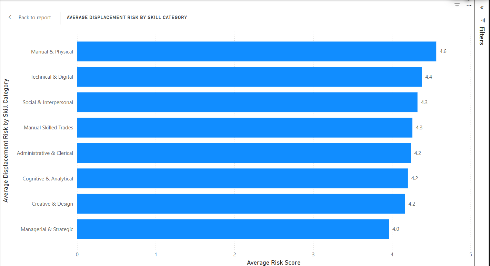

# 🤖 AI Workforce Impact Analysis

An end-to-end Data Analytics project that analyzes the impact of Artificial Intelligence on the global workforce using Python, SQL, PostgreSQL, and Power BI.

This project demonstrates the complete analytics workflow—from business understanding and data cleaning to exploratory data analysis, SQL querying, and interactive dashboard creation.

---

# 📌 Project Objective

Artificial Intelligence is transforming industries worldwide by improving productivity while also changing employment patterns.

The objective of this project is to analyze:

- AI adoption across countries and industries
- Workforce displacement risk
- Jobs created vs. jobs displaced
- Skill categories most affected by AI
- Geographic patterns of AI adoption
- Workforce trends before and after the Generative AI era

---

# 🛠️ Tech Stack

- Microsoft Excel
- Python
- Pandas
- NumPy
- Matplotlib
- Seaborn
- PostgreSQL
- DBeaver
- Power BI

---

# 📂 Project Structure

```
AI-Workforce-Impact-Analysis
│
├── 1.Business understanding
├── 2.Data
├── 3.Python
├── 4.SQL
├── 5.Power BI
├── 6.Images
├── README.md
├── requirements.txt
```

---

# 📊 Project Workflow

Business Understanding

↓

Data Cleaning (Excel)

↓

Exploratory Data Analysis (Python)

↓

Business Queries (SQL)

↓

Interactive Dashboard (Power BI)

↓

Business Insights

---

# 🐍 Python Analysis

Exploratory Data Analysis included:

- Data quality checks
- Missing value verification
- Summary statistics
- Distribution analysis
- Correlation analysis
- AI adoption trends
- Workforce impact analysis
- Jobs created vs jobs displaced
- Risk score analysis

---

# 🗄️ SQL Analysis

Business questions answered using PostgreSQL:

- Average AI adoption rate
- Jobs displaced by industry
- AI adoption by country
- Skill category risk analysis
- AI adoption before vs after Generative AI
- Industry-wise workforce impact
- Advanced analytical queries using JOINs, GROUP BY, HAVING, CTEs, and Window Functions

---

# 📈 Power BI Dashboard

The interactive dashboard includes:

### KPI Cards

- Average AI Adoption Rate
- Average Displacement Risk
- Total Jobs Created
- Total Jobs Displaced

### Visualizations

- AI Adoption Before vs After Generative AI
- Average Jobs Displaced by Industry
- Average Displacement Risk by Skill Category
- AI Adoption by Country (Map)

### Interactive Filters

- Country
- Industry
- Year

---

# 📷 Dashboard Preview


## Key Visualizations

### Average Jobs Displaced by Industry


### Average Displacement Risk by Skill Category


# 🔍 Key Insights

- AI adoption increased significantly during the Generative AI era.
- AI adoption alone does not strongly correlate with job displacement.
- Media & Entertainment, Food & Beverage, and Manufacturing experienced higher workforce displacement.
- Manual and technical skill categories show higher displacement risk.
- Jobs displaced exceed jobs created in the current dataset.
- Workforce impact varies considerably across industries and countries.

---

# 💡 Business Recommendations

- Increase investment in workforce reskilling programs.
- Prioritize AI adoption alongside employee upskilling.
- Focus policy support on industries with higher automation risk.
- Encourage continuous learning in technical and analytical skills.
- Monitor AI adoption trends to support evidence-based workforce planning.

---

# 🚀 Skills Demonstrated

- Data Cleaning
- Data Analysis
- Exploratory Data Analysis (EDA)
- Data Visualization
- SQL Querying
- Database Design
- Power BI Dashboard Development
- Business Intelligence
- Storytelling with Data

---

# 📬 Contact

**Sandeep**

LinkedIn: (https://www.linkedin.com/in/sandeep-patnaik-666b612aa/)

GitHub: (https://github.com/Sandeep-Patnaik)

---

⭐ If you found this project interesting, consider giving it a star!
